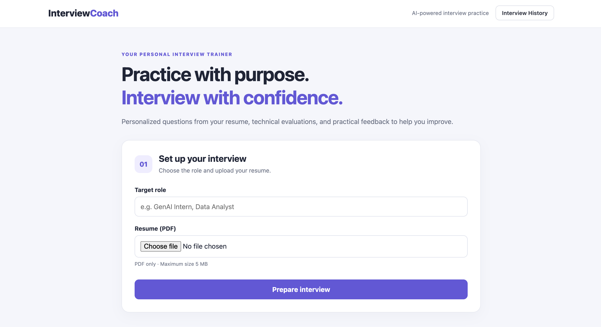
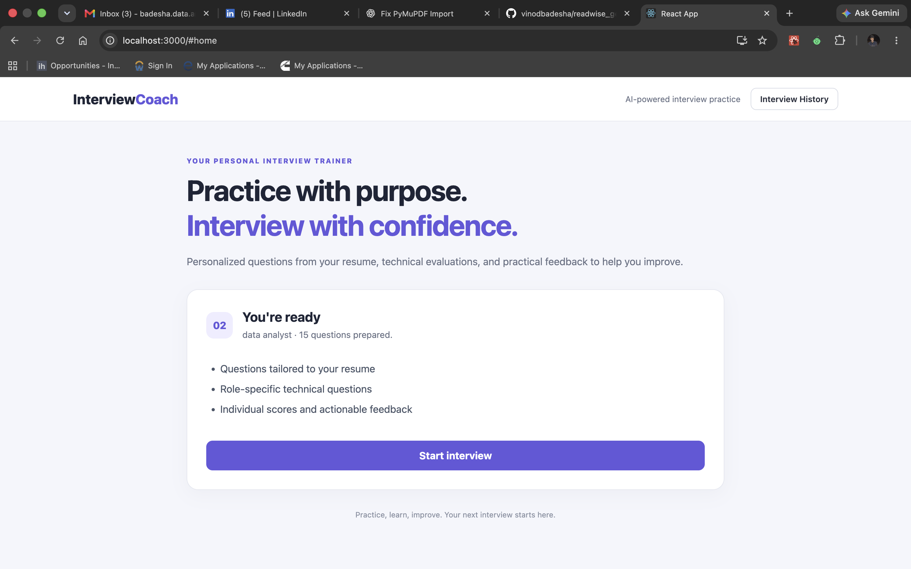
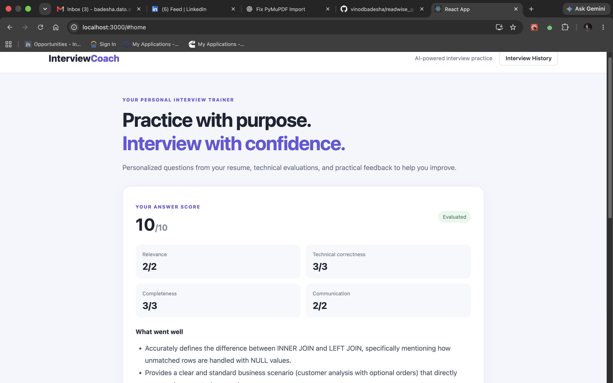
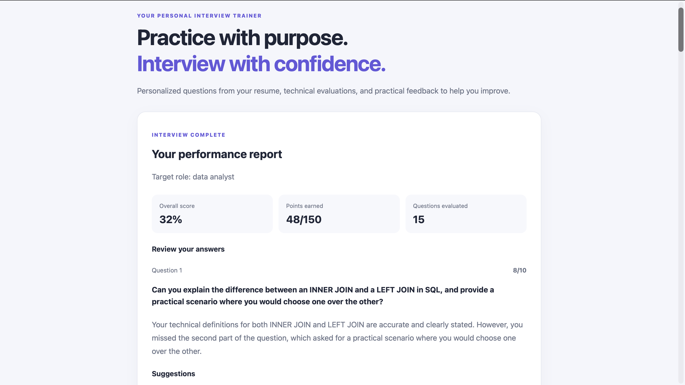
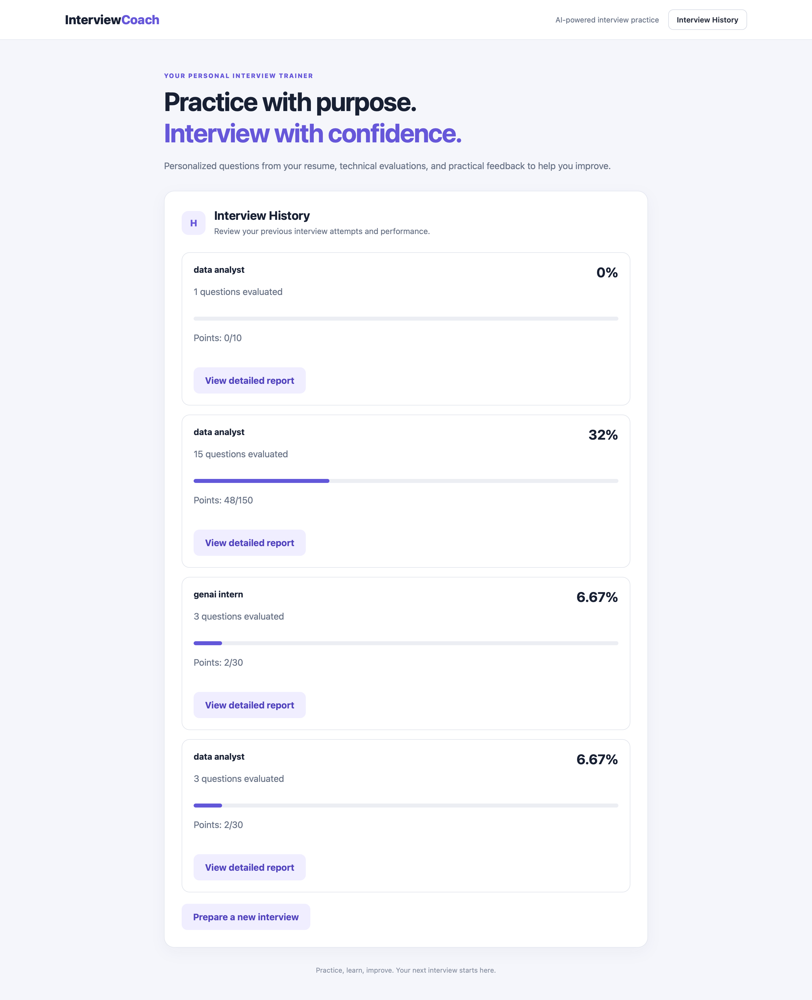

# 🎯 AI Interview Coach

Practice job interviews using your resume and get AI-powered feedback on your answers. Upload a PDF resume, choose a target role, answer interview questions, and review a report highlighting your performance and areas to improve.

Built with **FastAPI, React, Python, JavaScript, and the Google Gemini API**.




---

## ✨ What this project demonstrates

- **Resume analysis:** extracts skills and projects from an uploaded PDF resume.
- **Role-specific interview preparation:** combines a question bank with questions generated from the candidate's resume.
- **AI-powered answer evaluation:** evaluates submitted answers against expected key points and returns feedback.
- **Interview workflow:** manages preparation, question progression, feedback, and the final report.
- **Structured LLM output:** prompts Gemini to return structured data that the backend validates before using it.
- **Full-stack integration:** React communicates with a FastAPI backend through HTTP endpoints.
- **Error handling:** validates uploaded files and handles failures during analysis and question generation.

> Features and results described here should match the current implementation. Update this section as you verify additional features.

---

## 🧱 Tech Stack

| Component | Technology |
|---|---|
| LLM | Google Gemini API |
| Backend API | FastAPI |
| Backend language | Python |
| Frontend | React |
| Frontend language | JavaScript |
| Resume parsing | `resume_reader.py` and its PDF parsing dependency |
| Question generation | Python question bank + Gemini |
| Answer evaluation | Python evaluator + Gemini or the configured evaluation logic |
| Development server | Uvicorn |
| Frontend tooling | Create React App / `react-scripts` |

---

## 📂 Project structure

```text
ai_interviewer/
├── api.py                 # FastAPI endpoints and interview-session workflow
├── analyze.py             # Gemini client, resume analysis, JSON parsing
├── resume_reader.py       # Extracts text from the uploaded resume
├── questions_gen.py       # Selects and generates interview questions
├── evaluator.py           # Scores answers and creates feedback
├── questions.json         # Curated interview question bank
├── requirements.txt       # Python dependencies
└── frontend/
    ├── package.json       # JavaScript dependencies and development scripts
    ├── public/
    └── src/
        ├── App.js         # Main React application and interview flow
        └── App.css        # Application styling
```

*The tree above is a guide to the main files. Keep it aligned with the files actually present in your repository.*

---

## ⚙️ Setup

### 1. Clone the repository

Replace the URL below with the URL of your GitHub repository.

```bash
git clone https://github.com/YOUR_USERNAME/ai_interviewer.git
cd ai_interviewer
```

### 2. Create a Python virtual environment

```bash
python3 -m venv .venv
source .venv/bin/activate
```

On Windows, activate it with:

```powershell
.venv\Scripts\activate
```

### 3. Install backend dependencies

```bash
pip install -r requirements.txt
```

### 4. Configure the Gemini API key

Get an API key through [Google AI Studio](https://aistudio.google.com/).

Set it as an environment variable. Do not put your actual key in source code or commit it to GitHub.

macOS / Linux:

```bash
export GEMINI_API_KEY="your-gemini-api-key"
```

Windows PowerShell:

```powershell
$env:GEMINI_API_KEY="your-gemini-api-key"
```

The Google GenAI client can read the key from the environment. Confirm that the model configured in `analyze.py` is available to your API key.

### 5. Install frontend dependencies

Open a second terminal, go to the frontend directory, and install the dependencies:

```bash
cd frontend
npm install
```

---

## 🚀 Running locally

### Terminal 1 — Backend

From the project root, with the virtual environment activated and the API key configured:

```bash
python -m uvicorn api:app --reload --port 8000
```

The FastAPI server will run at:

- API: `http://127.0.0.1:8000`
- Interactive API documentation: `http://127.0.0.1:8000/docs`

### Terminal 2 — Frontend

```bash
cd frontend
npm start
```

Create React App typically opens the frontend at `http://localhost:3000`. Use the address shown in your terminal if it differs.

---

## 💡 How it works

1. **Resume upload:** The user selects a target role and uploads a PDF resume through the React interface.
2. **Text extraction:** The backend passes the uploaded file to the resume-reading function to extract its text.
3. **Resume analysis:** `analyze.py` sends a prompt to Gemini requesting structured resume information, including skills and projects. The response is parsed and validated.
4. **Question preparation:** `questions_gen.py` selects questions from `questions.json` and generates additional questions tied to the resume.
5. **Interview session:** The backend maintains the current question and the session's answer results while the candidate progresses through the interview.
6. **Answer evaluation:** `evaluator.py` evaluates each submitted answer and produces a score and feedback based on the configured evaluation logic.
7. **Final report:** The frontend displays the interview results and feedback returned by the backend.

---

## 🧠 Key implementation details

### Resume analysis with Gemini

The resume-analysis prompt requests a predictable JSON structure rather than unrestricted prose. The backend parses the model response and checks that expected fields, such as `skills` and `projects`, are present before continuing.

### Question generation

The question-generation module combines a curated question bank with resume-specific questions. This provides coverage of role-related topics while allowing questions to reference projects and skills mentioned in the candidate's resume.

### Answer evaluation

Answers are evaluated against expected key points. The evaluation output is used to give the candidate feedback on strengths and areas to improve.

### Backend and frontend separation

FastAPI handles file uploads, session state, question progression, and evaluation requests. React handles the user interface, input state, loading and error messages, and report presentation.





---

## 🛠️ Challenges and possible improvements

These are potential improvement areas; include only the challenges you have actually encountered or tested when describing them as completed work.

- **Variable LLM response time:** Measure individual Gemini calls, reduce unnecessary calls, and use clear loading states.
- **Invalid model output:** Validate JSON responses and handle malformed or incomplete output safely.
- **Question repetition:** Deduplicate generated questions and compare them with questions already selected.
- **Evaluation consistency:** Use a clear scoring rubric and test whether repeated evaluations of the same answer are reasonably consistent.
- **API failures and rate limits:** Handle authentication errors, rate limits, unavailable models, timeouts, and temporary service failures.
- **Session persistence:** If sessions are currently stored only in memory, consider persistent storage so interview history survives a backend restart.
- **File safety:** Validate file type and size, use temporary files safely, and avoid retaining uploaded resumes unnecessarily.

---

## 🧪 Testing and evaluation

Before publishing performance claims, test the application with multiple resumes and target roles.

Suggested checks:

| Test | What to verify |
|---|---|
| Valid PDF | Resume text is extracted and analysis returns the expected fields |
| Empty or unreadable PDF | The application shows a useful error rather than hanging |
| Different target roles | Questions are relevant to the selected role |
| Resume-specific questions | Generated questions refer to skills or projects actually present in the resume |
| Short and detailed answers | Evaluation produces useful, appropriately differentiated feedback |
| Gemini API failure | The UI recovers gracefully and communicates the error |
| End interview early | The report handles a partially completed interview correctly |
| Repeated sessions | Session results do not leak between interviews |

Record actual test counts and outcomes here after running these checks. Do not publish invented accuracy percentages or latency claims.

---

## 🔎 Example interview topics

The exact questions depend on the selected role, the question bank, and the resume. Examples of topics you can test include:

- Explain a project listed on your resume and the decisions you made.
- Why did you choose the technologies used in that project?
- What technical challenge did you encounter, and how did you solve it?
- How would you improve the project if you had more time?
- Explain a core concept relevant to your target role.

---

## 📌 Notes and limitations

- Gemini API availability, latency, quotas, and rate limits depend on the model and account configuration.
- Model-generated questions and feedback can be inaccurate; candidates should treat them as practice guidance, not authoritative hiring decisions.
- Resume analysis depends on the quality of text extracted from the uploaded PDF.
- Generated question quality depends on the resume content, prompts, and question-generation logic.
- The current session-storage approach should be checked before claiming that interviews persist across server restarts.
- This is an interview-practice tool, not a replacement for a human interviewer.

---

## 🗺️ Future improvements

- Reduce preparation latency by measuring and optimizing individual LLM calls.
- Add more robust validation and retry policies for model responses.
- Improve question deduplication and role coverage.
- Add persistent interview history and exportable reports.
- Expand test coverage for PDF edge cases, API failures, and scoring consistency.
- Add a clear explanation of the scoring rubric so candidates understand how feedback is produced.

---

## 🔐 Security

- Never commit API keys, `.env` files, personal resumes, or other private data.
- Keep secrets in environment variables or a local, ignored configuration file.
- Review uploaded-file handling and data retention before deploying the application publicly.
